# Relatório dos testes de carga

Gerado em 2026-10-20T22:04:37+00:00.

## Metodologia

Foram combinados três cenários de conteúdo, três quantidades de usuários e três quantidades de instâncias WordPress. O Locust enviou as requisições ao Nginx, que as distribuiu entre as instâncias ativas.

- Execuções processadas: 27
- Duração registrada por execução: 20 s
- Processos do Locust por execução: 2
- Requisições totais: 100690
- Falhas totais: 15155

## Resultados consolidados

| Cenário | Instâncias | Usuários | Requisições | Falhas | Taxa de falhas | Média (ms) | P95 (ms) | RPS |
| --- | ---: | ---: | ---: | ---: | ---: | ---: | ---: | ---: |
| Post com imagem de aproximadamente 1 MB | 1 | 10 | 208 | 0 | 0.00% | 13.9 | 43.0 | 19.01 |
| Post com imagem de aproximadamente 1 MB | 1 | 100 | 2100 | 0 | 0.00% | 16.3 | 45.0 | 191.24 |
| Post com imagem de aproximadamente 1 MB | 1 | 1000 | 7358 | 345 | 4.69% | 544.7 | 2700.0 | 897.74 |
| Post com imagem de aproximadamente 1 MB | 2 | 10 | 226 | 0 | 0.00% | 11.3 | 31.0 | 20.76 |
| Post com imagem de aproximadamente 1 MB | 2 | 100 | 2093 | 0 | 0.00% | 16.5 | 46.0 | 191.50 |
| Post com imagem de aproximadamente 1 MB | 2 | 1000 | 10551 | 1222 | 11.58% | 390.9 | 980.0 | 981.26 |
| Post com imagem de aproximadamente 1 MB | 3 | 10 | 202 | 0 | 0.00% | 11.9 | 32.0 | 18.68 |
| Post com imagem de aproximadamente 1 MB | 3 | 100 | 2131 | 0 | 0.00% | 16.3 | 45.0 | 194.12 |
| Post com imagem de aproximadamente 1 MB | 3 | 1000 | 9863 | 1467 | 14.87% | 496.0 | 1500.0 | 920.50 |
| Post com imagem de aproximadamente 300 KB | 1 | 10 | 212 | 0 | 0.00% | 10.9 | 32.0 | 19.66 |
| Post com imagem de aproximadamente 300 KB | 1 | 100 | 2155 | 0 | 0.00% | 14.1 | 43.0 | 196.66 |
| Post com imagem de aproximadamente 300 KB | 1 | 1000 | 11735 | 185 | 1.58% | 211.4 | 430.0 | 1080.66 |
| Post com imagem de aproximadamente 300 KB | 2 | 10 | 222 | 0 | 0.00% | 10.9 | 32.0 | 20.31 |
| Post com imagem de aproximadamente 300 KB | 2 | 100 | 2118 | 0 | 0.00% | 15.7 | 45.0 | 193.09 |
| Post com imagem de aproximadamente 300 KB | 2 | 1000 | 13113 | 1375 | 10.49% | 271.2 | 640.0 | 1180.24 |
| Post com imagem de aproximadamente 300 KB | 3 | 10 | 212 | 0 | 0.00% | 11.3 | 34.0 | 19.58 |
| Post com imagem de aproximadamente 300 KB | 3 | 100 | 2176 | 0 | 0.00% | 14.3 | 41.0 | 198.99 |
| Post com imagem de aproximadamente 300 KB | 3 | 1000 | 12748 | 2183 | 17.12% | 305.1 | 880.0 | 1180.00 |
| Post com texto de aproximadamente 400 KB | 1 | 10 | 107 | 0 | 0.00% | 33.8 | 53.0 | 10.01 |
| Post com texto de aproximadamente 400 KB | 1 | 100 | 1054 | 0 | 0.00% | 37.2 | 60.0 | 96.14 |
| Post com texto de aproximadamente 400 KB | 1 | 1000 | 3555 | 96 | 2.70% | 637.3 | 910.0 | 328.03 |
| Post com texto de aproximadamente 400 KB | 2 | 10 | 113 | 0 | 0.00% | 34.3 | 54.0 | 10.39 |
| Post com texto de aproximadamente 400 KB | 2 | 100 | 1073 | 0 | 0.00% | 41.6 | 67.0 | 98.00 |
| Post com texto de aproximadamente 400 KB | 2 | 1000 | 6909 | 3852 | 55.75% | 612.0 | 3100.0 | 636.92 |
| Post com texto de aproximadamente 400 KB | 3 | 10 | 106 | 0 | 0.00% | 35.0 | 54.0 | 9.69 |
| Post com texto de aproximadamente 400 KB | 3 | 100 | 1051 | 0 | 0.00% | 39.5 | 63.0 | 95.70 |
| Post com texto de aproximadamente 400 KB | 3 | 1000 | 7299 | 4430 | 60.69% | 437.2 | 1200.0 | 673.60 |

## Análise dos resultados

- Nas 18 execuções com 10 ou 100 usuários não houve falhas, independentemente da quantidade de instâncias.
- Com 1000 usuários, o aumento de instâncias elevou a vazão em vários casos, mas também expôs contenção nos recursos compartilhados. Por isso, RPS, latência e taxa de falhas devem ser analisados em conjunto.
- Em **Post com imagem de aproximadamente 1 MB**, a maior vazão com 1000 usuários foi 981.26 RPS com 2 instância(s), acompanhada de 11.58% de falhas.
- Em **Post com texto de aproximadamente 400 KB**, a maior vazão com 1000 usuários foi 673.60 RPS com 3 instância(s), acompanhada de 60.69% de falhas.
- Em **Post com imagem de aproximadamente 300 KB**, a maior vazão com 1000 usuários foi 1180.24 RPS com 2 instância(s), acompanhada de 10.49% de falhas.
- Os resultados indicam que adicionar servidores WordPress isoladamente não garante maior confiabilidade: banco de dados, volume compartilhado e capacidade da própria máquina de testes também podem se tornar gargalos.
- Os números representam esta máquina e esta duração de teste; repetições mais longas são recomendadas antes de extrapolar os resultados para produção.

## Gráficos

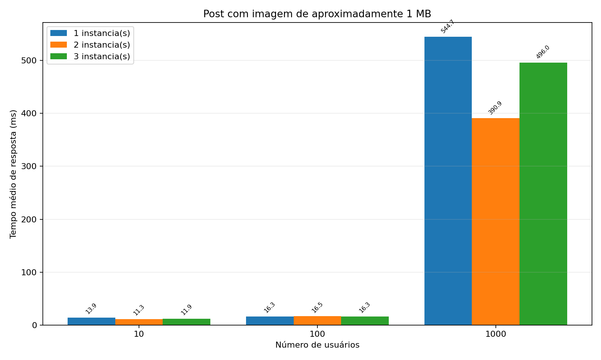

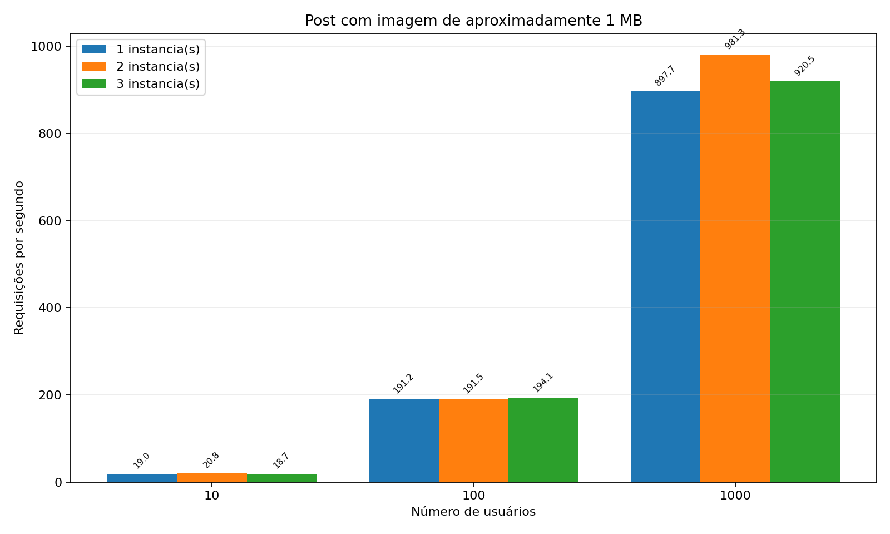

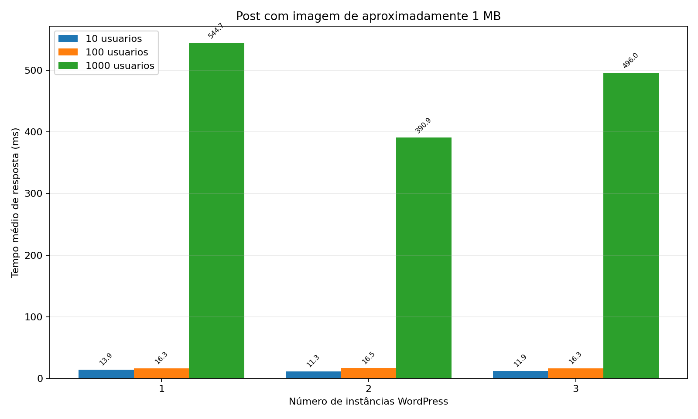

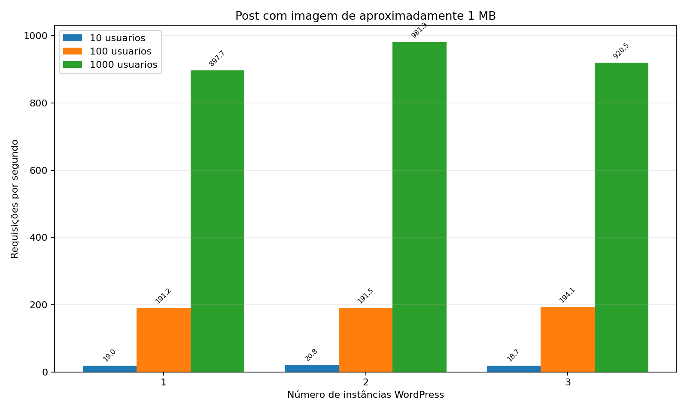

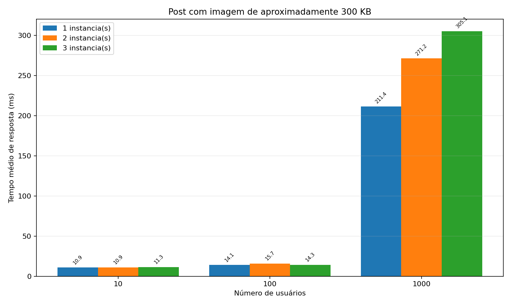

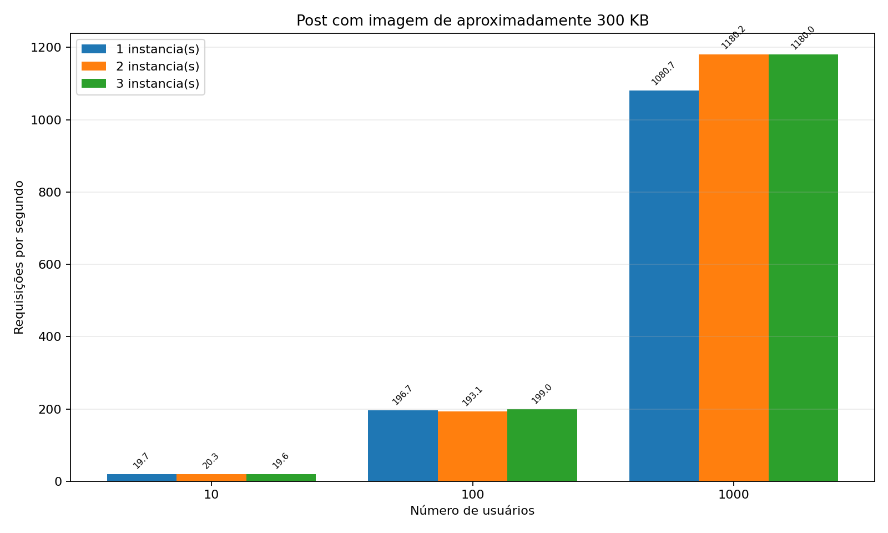

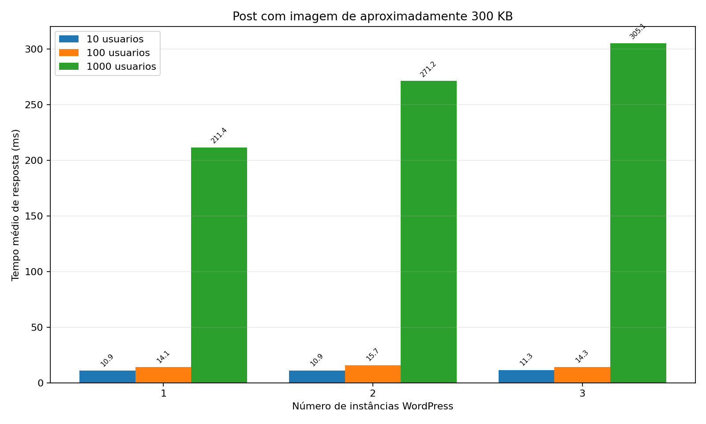

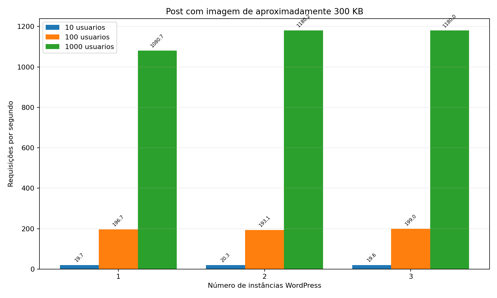

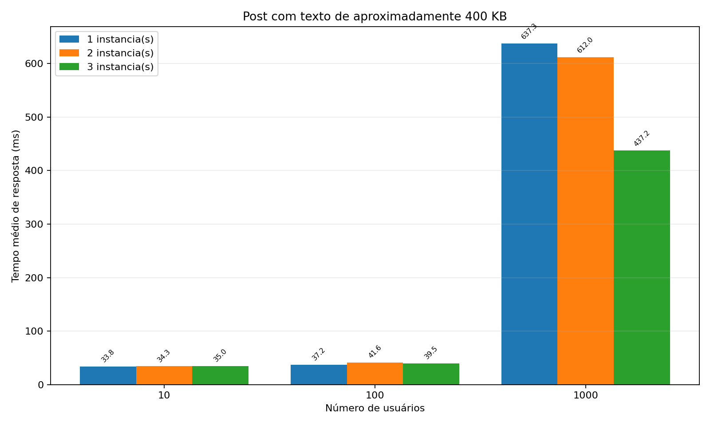

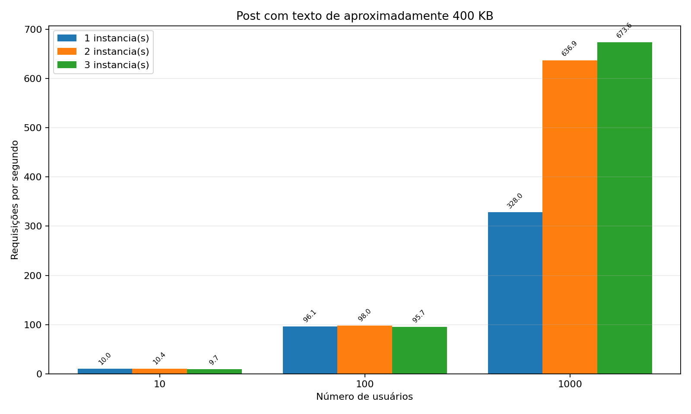

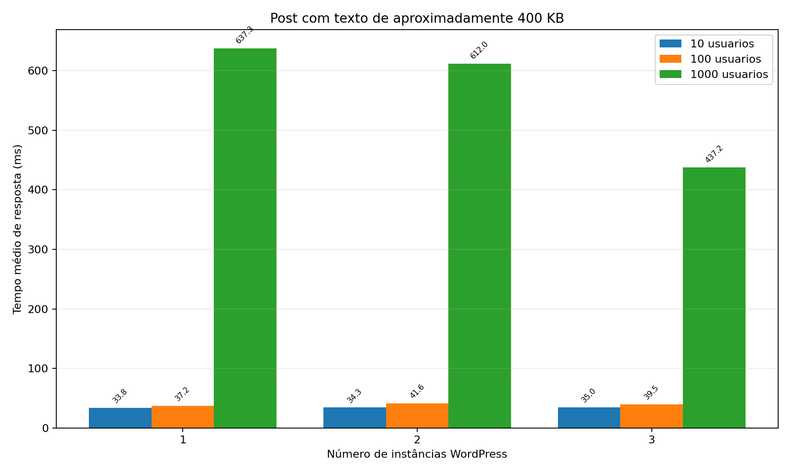

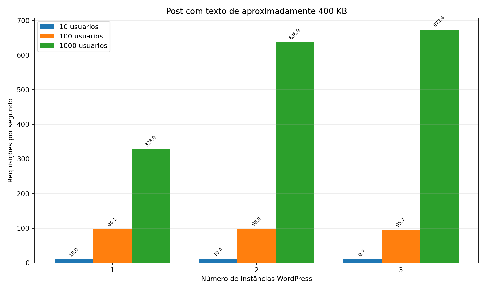
